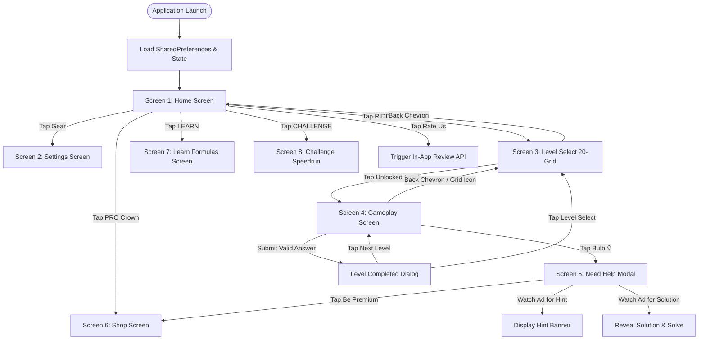
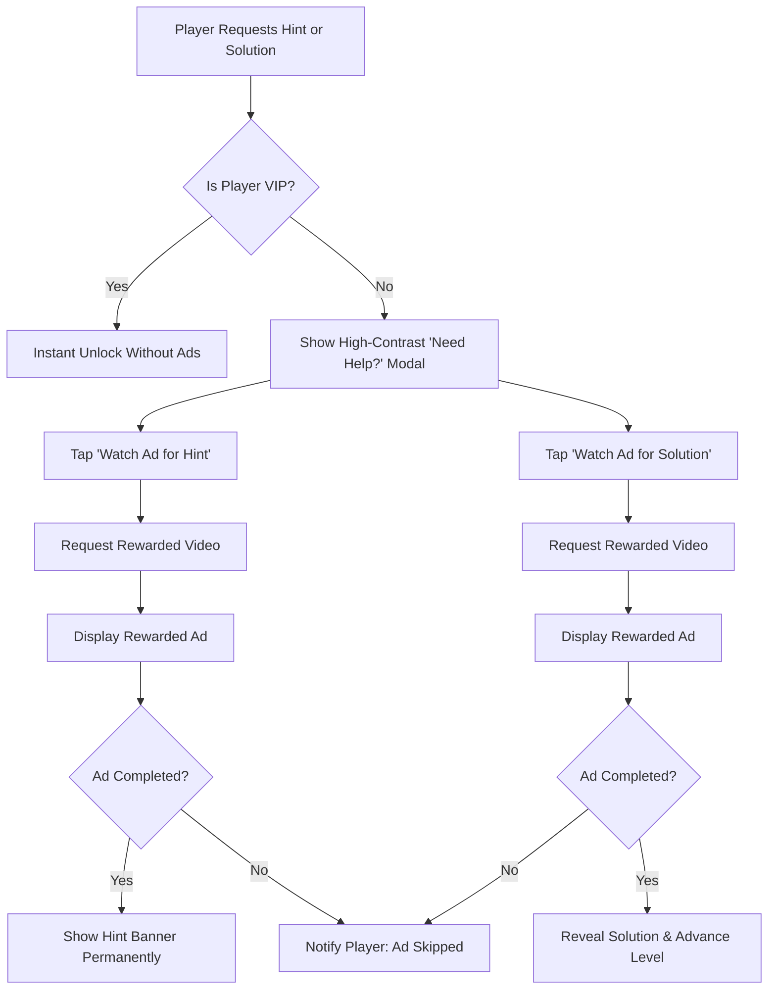
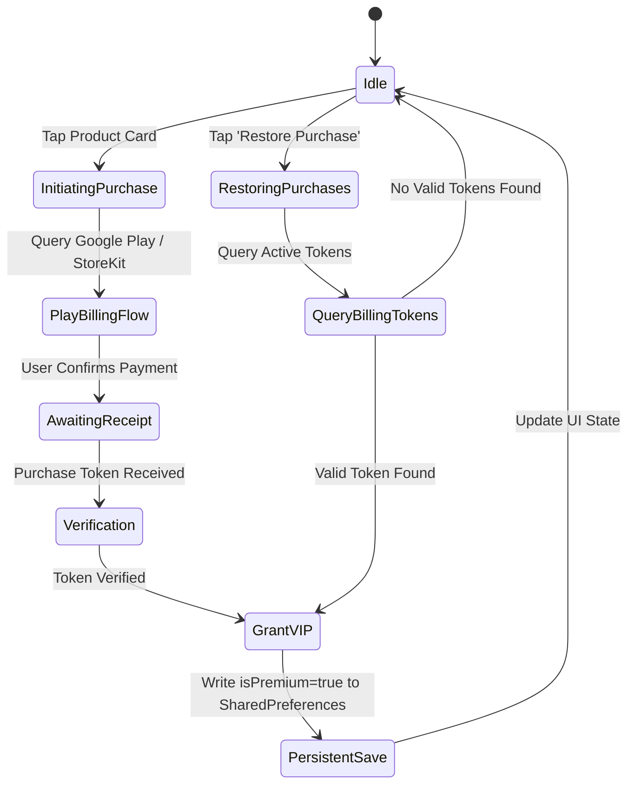

# Math Riddles & Mind Logic — Exhaustive Product & Technical Specification

> **Document Type:** Product Requirements Document (PRD) & Technical Specification Document (TSD)  
> **Version:** 2.19.0 (Production Release)  
> **Target Framework:** Flutter 3.27+ / 3.47+ (Dart 3.6+)  
> **Target Platforms:** Android (API 26–36) & iOS (iOS 14.0+)  
> **Visual Aesthetic:** Minimalist Deep Dark Mode (#121418 / #1A1D24) with Warm Amber Accents (#E5A93C / #F37A1F)  
> **Inspiration:** *Math | Riddles and Puzzle Game* by Black Games

---

## Executive Summary

**Math Riddles & Mind Logic** is an ultra-minimalist, distraction-free mobile logic puzzle game engineered for pure intellectual engagement. Stripping away cartoon characters, coin economies, and invasive full-screen popups, the game delivers handcrafted mathematical and lateral-logic riddles across geometric figures, numeric matrices, and algebraic sequences.

The application is architected around offline-first persistence, reactive state management using **Riverpod 3**, vector-based rendering via **CustomPainter**, and an **inbuilt virtual numeric keypad** that completely bypasses operating-system soft keyboards for tactile, one-handed mobile control.

---

## Table of Contents
1. [Core Concept & Product Vision](#1-core-concept--product-vision)
   - [Product Pillars & Core Values](#product-pillars--core-values)
   - [Lateral Logic Mathematical Philosophy](#lateral-logic-mathematical-philosophy)
   - [Target Audience & Player Personas](#target-audience--player-personas)
2. [Design System & UI Standards](#2-design-system--ui-standards)
   - [Color Palette & Hex Specifications](#color-palette--hex-specifications)
   - [Typography Hierarchy & Letter Tracking](#typography-hierarchy--letter-tracking)
   - [UI Component Specifications & ASCII Wireframes](#ui-component-specifications--ascii-wireframes)
   - [Animation Choreography & Haptics](#animation-choreography--haptics)
3. [Screen-by-Screen Architecture & User Flows](#3-screen-by-screen-architecture--user-flows)
   - [Global Screen Navigation State Diagram](#global-screen-navigation-state-diagram)
   - [Screen 1: Home Screen](#screen-1-home-screen)
   - [Screen 2: Settings Screen](#screen-2-settings-screen)
   - [Screen 3: Riddle Level Select (20-Container Grid)](#screen-3-riddle-level-select-20-container-grid)
   - [Screen 4: Question & Riddle Gameplay Screen (5-Min Timer & Keypad)](#screen-4-question--riddle-gameplay-screen)
   - [Screen 5: "Need Help?" Modal (High-Contrast Popup)](#screen-5-need-help-modal)
   - [Screen 6: Shop / Premium Subscription Screen](#screen-6-shop--premium-subscription-screen)
   - [Screen 7: Learn Screen (Mental Math Concepts)](#screen-7-learn-screen)
   - [Screen 8: Challenge Screen (Endless Speedrun Mode)](#screen-8-challenge-screen)
4. [Puzzle Engine & Level Data Model](#4-puzzle-engine--level-data-model)
   - [Data Schema (Dart Model)](#data-schema-dart-model)
   - [Vector Canvas Rendering Archetypes](#vector-canvas-rendering-archetypes)
   - [Complete 20-Level Mathematical Master Catalog](#complete-20-level-mathematical-master-catalog)
5. [Ad Strategy & Monetization Architecture](#5-ad-strategy--monetization-architecture)
   - [Ad Units, Frequency Caps & Lifecycle Triggers](#ad-units-frequency-caps--lifecycle-triggers)
   - [Rewarded Video Implementation Rules](#rewarded-video-implementation-rules)
   - [Interstitial Cadence & Suppression](#interstitial-cadence--suppression)
   - [GDPR / CCPA Privacy & Consent Protocols](#gdpr--ccpa-privacy--consent-protocols)
6. [In-App Purchases & Pricing Model](#6-in-app-purchases--pricing-model)
   - [Product Tiers & Multi-Currency Pricing](#product-tiers--multi-currency-pricing)
   - [Comprehensive Feature Matrix](#comprehensive-feature-matrix)
   - [Billing State Machine & Purchase Restoration](#billing-state-machine--purchase-restoration)
7. [Technical Architecture & State Management](#7-technical-architecture--state-management)
   - [Riverpod 3 Notifier State Lifecycle](#riverpod-3-notifier-state-lifecycle)
   - [Offline Persistence & SharedPreferences Schema](#offline-persistence--sharedpreferences-schema)
   - [Error Handling & Edge Cases](#error-handling--edge-cases)
8. [Setup, Build & Test Verification](#8-setup-build--test-verification)

---

## 1. Core Concept & Product Vision

### Product Pillars & Core Values

1. **Zero Distraction, Pure Intellect:**
   Eliminates all superfluous game mechanics: no spinning wheels, daily login streaks, cartoon mascots, or energy timers. The interface remains quiet, dark, and scholarly.
2. **Tactile Virtual Control (No OS Keyboard):**
   The operating system virtual keyboard is entirely suppressed. The gameplay canvas is paired with an inbuilt, custom-tuned dark numeric keypad with zero input latency and dedicated actions (`0-9`, `ENTER`, `✕` Clear, and `💡` Hint).
3. **Rigorous Lateral Logic:**
   Challenges test lateral arithmetic and spatial deduction rather than rote computational speed. Puzzles incorporate geometric patterns, matrix determinants, functional transforms, and progressive number sequences.
4. **100% Offline-Capable Core:**
   Every level, hint, explanation, and persistent state can be experienced entirely without an active internet connection.

```
       ┌────────────────────────────────────────────────────────┐
       │             CORE PRODUCT PILLARS                       │
       ├─────────────────┬──────────────────┬───────────────────┤
       │ Pure Intellect  │  Virtual Keypad  │  Offline-First    │
       │ No cartoon UI   │  No native soft  │  100% playable    │
       │ No coin casino  │  keyboard popups │  without network  │
       └─────────────────┴──────────────────┴───────────────────┘
```

### Lateral Logic Mathematical Philosophy

The aesthetic and intellectual spirit of the game is anchored to the quote rendered on the Home Screen:
> *“Logic is the anatomy of thought. Challenge your limits.”*

Rather than testing conventional academic arithmetic, puzzles are grouped into three cognitive domains:
* **Functional Transforms:** Puzzles where the basic operator symbols ($+$, $\times$, $-$) indicate a custom hidden binary operation (e.g., $a \oplus b = a \cdot b + a$).
* **Spatial & Geometric Reasoning:** Geometric networks where peripheral nodes transmit values toward central target nodes via geometric relations (Pythagorean triples, radial sum rules, inscribed ratios).
* **Matrix Symmetries:** 2x2 and 3x3 grids where rows, columns, and diagonals maintain arithmetic parity or exponential progression.

### Target Audience & Player Personas

| Persona | Demographics | Motivation | Pain Point in Competing Apps |
|:---|:---|:---|:---|
| **The STEM Professional / Student** | Ages 18–35; Engineers, Developers, Competitive Exam Candidates | Enjoys rigorous mental challenges, problem-solving, and logic tests. | Hates childish graphics, forced tutorials, and excessive ads. |
| **The Commuter Thinker** | Ages 22–50; Daily transit commuters, busy professionals | Wants 3–5 minutes of focused mental workout between stations. | Frustrated by complex menu systems, heavy load times, and required internet. |
| **The Minimalist Puzzle Purist** | Ages 16–60; Sudoku, Chess, and Crossword players | Appreciates clean typographic design, dark themes, and quiet focus. | Annoyed by flashing microtransaction banners and coin-based hint economies. |

---

## 2. Design System & UI Standards

### Color Palette & Hex Specifications

The visual identity follows an ultra-clean, high-contrast monochrome dark mode with warm amber/orange highlights and an off-white dialog system.

```
 [ #121418 ]  Background Dark       (Global Scaffold)
 [ #1A1D24 ]  Surface Dark          (Cards, Keypad Keys, Bars)
 [ #222630 ]  Surface Elevated      (Active Key Feedback, Modals)
 [ #2A2E39 ]  Border Subtle         (1px Structural Outlines)
 [ #282828 ]  Border Charcoal       (Dividers & Inactive Grids)
 [ #E5A93C ]  Accent Amber          (Target '?' Box, Active Level)
 [ #F37A1F ]  Accent Orange         (PRO Crown Badge, High-CTA)
 [ #FFFFFF ]  Text Pure White       (Headers, Primary Digits)
 [ #8C93A8 ]  Text Muted            (Secondary Labels, Padlocks)
 [ #F5F6F8 ]  Modal High-Contrast   (Help Dialog Light Surface)
 [ #121418 ]  Modal Text Dark       (Dark Text on Light Dialog)
 [ #E74C3C ]  Error Red             (Input Shake & Failures)
 [ #2ECC71 ]  Success Green         (Checkmarks & Solved Badges)
```

#### Detailed Color Token Table

| Token Identifier | Hex Code | Flutter Constant (`GameTheme`) | UI Usage & Semantic Role |
|:---|:---|:---|:---|
| `backgroundDark` | `#121418` | `Color(0xFF121418)` | Global background for all screens and scaffold views |
| `surfaceDark` | `#1A1D24` | `Color(0xFF1A1D24)` | Card surfaces, virtual keypad tiles, top app bar |
| `surfaceElevated`| `#222630` | `Color(0xFF222630)` | Active pressed tiles, floating card elevation |
| `borderSubtle` | `#2A2E39` | `Color(0xFF2A2E39)` | 1px border on cards, level containers, and keypad |
| `borderCharcoal`| `#282828` | `Color(0xFF282828)` | Divider lines, inactive borders |
| `accentAmber` | `#E5A93C` | `Color(0xFFE5A93C)` | Current level border, target question mark `?` node |
| `accentOrange` | `#F37A1F` | `Color(0xFFF37A1F)` | PRO VIP crown badge, primary interactive actions |
| `textWhite` | `#FFFFFF` | `Color(0xFFFFFFFF)` | Primary titles, keypad numbers, high-contrast labels |
| `textMuted` | `#8C93A8` | `Color(0xFF8C93A8)` | Subtitles, disabled states, locked level indicators |
| `modalSurface` | `#F5F6F8` | `Color(0xFFF5F6F8)` | High-contrast "Need Help?" popup background |
| `modalTextDark` | `#121418` | `Color(0xFF121418)` | High-contrast black typography on modal popups |
| `modalTextMuted`| `#4A5060` | `Color(0xFF4A5060)` | Secondary explanations in high-contrast modals |
| `errorRed` | `#E74C3C` | `Color(0xFFE74C3C)` | Input validation shake outline, delete warning |
| `successGreen` | `#2ECC71` | `Color(0xFF2ECC71)` | Solved level checkmarks, progression confirm |

### Typography Hierarchy & Letter Tracking

The interface utilizes clean, geometric sans-serif typefaces (Roboto on Android, San Francisco on iOS). Wide letter-spacing (tracking) gives the typography a refined, scholarly architectural feel.

| Element | Size | Weight | Tracking (Letter Spacing) | Color Token |
|:---|:---|:---|:---|:---|
| **App Title** (`MATH RIDDLES`) | `32sp` | Bold (700) | `4.0px` | `textWhite` |
| **Section Header** (`SETTINGS`, `LEVEL SELECT`) | `18sp` | SemiBold (600) | `2.5px` | `textWhite` |
| **Hero Quote** | `13sp` | Light (300) | `0.5px` (Italic) | `textMuted` |
| **Menu Action Buttons** (`RIDDLE`, etc.) | `16sp` | SemiBold (600) | `2.0px` | `textWhite` |
| **Keypad Digits** (`0`–`9`, `ENTER`) | `22sp` | Medium (500) | `1.0px` | `textWhite` |
| **Level Indicator & Timer** (`04:59`) | `16sp` | Bold (700) | `1.5px` | `textWhite` / `accentAmber` |
| **Level Grid Tiles** (`1`–`20`) | `18sp` | SemiBold (600) | `0.0px` | `textWhite` / `textMuted` |
| **Modal Headline** (`Need Help?`) | `22sp` | Bold (700) | `1.0px` | `modalTextDark` |

### UI Component Specifications & ASCII Wireframes

#### Virtual Keypad Component Specifications
* **Keypad Grid:** 4-row layout anchored to bottom screen edge.
* **Row 1:** `1`, `2`, `3`
* **Row 2:** `4`, `5`, `6`
* **Row 3:** `7`, `8`, `9`
* **Row 4:** `✕` (Clear/Delete), `0`, `ENTER` (Submit)
* **Touch Target Height:** Uniform `54dp` per key with `8dp` inter-key spacing.
* **Key Borders:** `1px` stroke, `Color(0xFF2A2E39)`, border radius `10dp`.
* **Haptic Profile:** Light impact on key press, medium on delete, heavy triple on error shake, heavy double on success.

```
       ┌──────────┬──────────┬──────────┐
       │    1     │    2     │    3     │
       ├──────────┼──────────┼──────────┤
       │    4     │    5     │    6     │
       ├──────────┼──────────┼──────────┤
       │    7     │    8     │    9     │
       ├──────────┼──────────┼──────────┤
       │  ✕ DEL   │    0     │  ENTER ↵ │
       └──────────┴──────────┴──────────┘
```

#### High-Contrast "Need Help?" Modal Specifications
* **Scrim Overlay:** Dark matte backdrop with 80% opacity (`#CC000000`).
* **Modal Dialog Box:** High-contrast off-white container (`#F5F6F8`), corner radius `20dp`, padding `24dp`.
* **Action Buttons:** Contained dark pill rows (`#121418` fill with `#FFFFFF` text) ensuring maximum visual affordance.

```
 ╔═══════════════════════════════════════════════╗
 ║                [💡 Need Help?]                ║
 ║                                               ║
 ║   Choose an option to reveal clues or unlock  ║
 ║   the mathematical solution.                  ║
 ║                                               ║
 ║  ┌─────────────────────────────────────────┐  ║
 ║  │ ▶ Watch Ad for Hint                    │  ║
 ║  └─────────────────────────────────────────┘  ║
 ║  ┌─────────────────────────────────────────┐  ║
 ║  │ 👑 Watch Ad for Solution OR Be Premium  │  ║
 ║  └─────────────────────────────────────────┘  ║
 ║                                               ║
 ║                [ No thanks ]                  ║
 ╚═══════════════════════════════════════════════╝
```

### Animation Choreography & Haptics

1. **Target Node Idle Pulse:**
   * **Target:** The missing value indicator (`?`) on the geometric canvas.
   * **Animation:** Scale animation from `1.0` to `1.08` and opacity from `0.85` to `1.0`.
   * **Duration:** `1400ms` with `Curves.easeInOut`, reversing indefinitely.
2. **Input Error Shake:**
   * **Trigger:** Incorrect value submitted via `ENTER`.
   * **Animation:** Horizontal translation offset `[-12, 12, -8, 8, -4, 4, 0]`.
   * **Duration:** `450ms` with `Curves.easeOut`.
   * **Visual:** Input container outline transitions from `#2A2E39` to `#E74C3C` (Error Red).
3. **Level Clear Success Dialog:**
   * **Trigger:** Exact match with `correctAnswer`.
   * **Animation:** Fade-in and scale-up from `0.9` to `1.0` with `Curves.elasticOut`.
   * **Haptics:** Success vibration notification.

---

## 3. Screen-by-Screen Architecture & User Flows

### Global Screen Navigation State Diagram



---

### Screen 1: Home Screen

```
 ┌───────────────────────────────────────────────┐
 │               [❤️ 5] [★ 125 PTS] [⚙]          │
 │                                   [👑]        │
 │                 MATH RIDDLES                  │
 │                                               │
 │    "Logic is the anatomy of thought.          │
 │     Challenge your limits."                   │
 │                                               │
 │         ┌───────────────────────────┐         │
 │         │  [▶]    R I D D L E       │         │
 │         └───────────────────────────┘         │
 │         ┌───────────────────────────┐         │
 │         │  [📖]   L E A R N         │         │
 │         └───────────────────────────┘         │
 │         ┌───────────────────────────┐         │
 │         │  [⏱]    C H A L L E N G E │         │
 │         └───────────────────────────┘         │
 │                                               │
 │               Rate Us ★★★★★                   │
 └───────────────────────────────────────────────┘
```

* **Top-Right Navigation Stack:**
  * **Compact Amber Score Indicator (`★ Total Points`):** Outlined minimalist dark pill displaying player's persistent points with animated value transitions, situated immediately beside the Settings gear icon. Tapping opens the Scoring System breakdown.
  * **Settings Gear Button:** Bordered circular outline (`42x42dp`), navigating to [SettingsScreen](file:///c:/Users/gokul/code/math/lib/screens/settings_screen.dart).
  * **PRO Crown Badge:** Bordered compact pill placed directly beneath the settings icon. Highlights an amber crown with `PRO` label; routes to [ShopScreen](file:///c:/Users/gokul/code/math/lib/screens/shop_screen.dart).
* **Center Branding & Hero Quote:**
  * Bold title: `MATH RIDDLES` (`32sp`, letter spacing `4.0px`).
  * Philosophical hero quote: *“Logic is the anatomy of thought. Challenge your limits.”* (`13sp`, italic, light grey).
* **Primary Menu Buttons:**
  * Three vertical stacked outline buttons with dark fill and subtle borders (`#2A2E39`):
    1. **RIDDLE:** Routes to [LevelsScreen](file:///c:/Users/gokul/code/math/lib/screens/levels_screen.dart).
    2. **LEARN:** Routes to [LearnScreen](file:///c:/Users/gokul/code/math/lib/screens/learn_screen.dart).
    3. **CHALLENGE:** Routes to [ChallengeScreen](file:///c:/Users/gokul/code/math/lib/screens/challenge_screen.dart).
* **Footer:**
  * Clean, interactive **Rate Us ★★★★★** button opening store review prompts.

---

### Screen 2: Settings Screen

```
 ┌───────────────────────────────────────────────┐
 │ [<] SETTINGS                                  │
 │                                               │
 │  ┌─────────────────────────────────────────┐  │
 │  │ 🔊 SOUND                          [ON]  │  │
 │  ├─────────────────────────────────────────┤  │
 │  │ 📳 VIBRATION                      [ON]  │  │
 │  ├─────────────────────────────────────────┤  │
 │  │ 🎬 ADS SETTING                     [>]  │  │
 │  ├─────────────────────────────────────────┤  │
 │  │ 🔄 RESTORE PURCHASE                [>]  │  │
 │  ├─────────────────────────────────────────┤  │
 │  │ 🗑 DELETE DATA                     [>]  │  │
 │  └─────────────────────────────────────────┘  │
 │                                               │
 │         Privacy Policy  •  Terms of Service   │
 └───────────────────────────────────────────────┘
```

* **Header:** Back chevron `<` with clean title `SETTINGS`.
* **Actionable Configuration Rows:**
  * **SOUND:** Toggle switch to activate/deactivate sound effects.
  * **VIBRATION:** Toggle switch to activate/deactivate haptic feedback.
  * **ADS SETTING:** Consent management and personalized ad preferences.
  * **RESTORE PURCHASE:** Queries Google Play Billing / Apple StoreKit to re-grant previous non-consumable and subscription purchases.
  * **DELETE DATA:** Warning-accented row with trash icon. Opens a confirmation modal: *“Reset all progress? This will lock all levels and clear timer records permanently.”*
* **Footer:** Clean text links for **Privacy Policy** and **Terms of Services**.

---

### Screen 3: Riddle Level Select (20-Container Grid)

```
 ┌───────────────────────────────────────────────┐
 │ [<] LEVEL SELECT                              │
 │                                               │
 │       ┌──────┐ ┌──────┐ ┌──────┐ ┌──────┐     │
 │       │ 1  ✓ │ │ 2  ✓ │ │ 3  ✓ │ │ 4  ✓ │     │
 │       └──────┘ └──────┘ └──────┘ └──────┘     │
 │       ┌──────┐ ┌──────┐ ┌──────┐ ┌──────┐     │
 │       │[5] ☼ │ │ 6  🔒│ │ 7  🔒│ │ 8  🔒│     │
 │       └──────┘ └──────┘ └──────┘ └──────┘     │
 │       ┌──────┐ ┌──────┐ ┌──────┐ ┌──────┐     │
 │       │ 9  🔒│ │10  🔒│ │11  🔒│ │12  🔒│     │
 │       └──────┘ └──────┘ └──────┘ └──────┘     │
 │       ┌──────┐ ┌──────┐ ┌──────┐ ┌──────┐     │
 │       │13  🔒│ │14  🔒│ │15  🔒│ │16  🔒│     │
 │       └──────┘ └──────┘ └──────┘ └──────┘     │
 │       ┌──────┐ ┌──────┐ ┌──────┐ ┌──────┐     │
 │       │17  🔒│ │18  🔒│ │19  🔒│ │20  🔒│     │
 │       └──────┘ └──────┘ └──────┘ └──────┘     │
 └───────────────────────────────────────────────┘
```

* **Header:** Back chevron `<` and `LEVEL SELECT` heading.
* **Responsive 20-Tile Grid:**
  * Exactly 20 uniform square boxes.
  * **Sequential Unlocking Rule:** Level 1 is unlocked by default. Level $N$ unlocks strictly when Level $N-1$ is solved.
  * **Tile States:**
    * **Completed:** Shows level digit in bold white with a green checkmark `✓`.
    * **Active (Current):** Highlighted with glowing amber border (`#E5A93C`) and active background.
    * **Locked:** Displays a muted padlock glyph with dim typography; touch events disabled.

---

### Screen 4: Question & Riddle Gameplay Screen

```
 ┌───────────────────────────────────────────────┐
 │ [<]        LEVEL 5   ⏱ 04:32             [⊞] │
 ├───────────────────────────────────────────────┤
 │                                               │
 │                     ( 5 )                     │
 │                     /   \                     │
 │                    / [ ? ]\                   │
 │                   /       \                   │
 │                ( 3 ) ---- ( 4 )               │
 │                                               │
 ├───────────────────────────────────────────────┤
 │  INPUT: [ 25 ]                [✕]   [💡 HELP] │
 ├───────────────────────────────────────────────┤
 │   ┌───────────┬───────────┬───────────┐       │
 │   │     1     │     2     │     3     │       │
 │   ├───────────┼───────────┼───────────┤       │
 │   │     4     │     5     │     6     │       │
 │   ├───────────┼───────────┼───────────┤       │
 │   │     7     │     8     │     9     │       │
 │   ├───────────┼───────────┼───────────┤       │
 │   │    DEL    │     0     │   ENTER   │       │
 │   └───────────┴───────────┴───────────┘       │
 └───────────────────────────────────────────────┘
```

* **Header Bar:**
  * Back Chevron `<` (navigates back to Level Select).
  * Center: **LEVEL X** indicator paired with a continuous active **5:00 countdown timer** formatted as `MM:SS`.
  * Right: Level Select shortcut icon `[⊞]`.
* **Central Puzzle Stage:**
  * Dynamic vector rendering via [`PuzzleCanvasPainter`](file:///c:/Users/gokul/code/math/lib/painters/puzzle_canvas_painter.dart) adapting to `Formula`, `Grid`, or `Geometry`.
  * Target value rendered as a stylized missing box (`?`) with idle pulse animation.
* **Bottom Keypad Stage:**
  * **Live Input Display Row:** Shows currently keyed-in characters in large white text with backspace `✕` button and bulb `💡` help shortcut.
  * **Virtual Numeric Keypad:** Built-in digits `0` to `9`, `DEL`, and `ENTER`.
  * **No native OS keyboard is ever shown.**
* **Validation & Level Progression:**
  * **Error:** Horizontal shake animation, red flash border, and haptic vibration.
  * **Success:** Triggers celebratory level completion modal displaying the solution explanation and a `NEXT LEVEL` direct progression button.

---

### Screen 5: "Need Help?" Modal

* Triggered exclusively by tapping the bulb icon `💡`.
* High-contrast off-white dialog (`#F5F6F8`) on dark backdrop (`#CC000000`).
* **Options:**
  1. `[▶] Watch Ad for Hint` — Displays the level clue upon video completion.
  2. `[👑] Watch Ad for Solution OR Be Premium` — Reveals full step-by-step mathematical derivation and auto-completes stage.
  3. `[✕] No thanks` — Dismisses the modal.

---

### Screen 6: Shop / Premium Subscription Screen

* Outlined pricing cards with benefits breakdown:
  1. **REMOVE ADS (`₹49 / $0.99`):** Permanent non-consumable removal of interstitials and banners.
  2. **A MONTH PREMIUM (`₹99 / $1.99/mo`):** Auto-renewing subscription with zero ads, instant hints, and instant solutions.
  3. **LIFETIME PREMIUM (`₹199 / $4.99`):** Permanent VIP status, offline solution unlocks, VIP crown badge forever.
* Includes **Restore Purchases** button in footer.

---

### Screen 7: Learn Screen
* Conceptual walkthrough of core logic archetypes:
  * Number sequence properties (Arithmetic, Geometric, Fibonacci, Lucas).
  * Mental arithmetic tricks (squaring numbers ending in 5, cross-multiplication).
  * Matrix symmetry and determinant intuition.

---

### Screen 8: Challenge Screen
* Speedrun challenge mode:
  * Continuous 60-second time-attack clock.
  * Randomly drawn riddles from completed level pool.
  * Instant $+10\text{s}$ time bonus on correct answer, $-5\text{s}$ penalty on incorrect submission.

---

## 4. Puzzle Engine & Level Data Model

### Data Schema (Dart Model)

The riddle engine in [`lib/models/level_model.dart`](file:///c:/Users/gokul/code/math/lib/models/level_model.dart) is represented by this schema:

```dart
enum QuestionType {
  Formula,
  Grid,
  Geometry,
}

class PuzzleNode {
  final String id;
  final String displayValue;
  final bool isTarget;
  final double relX; // 0.0 (left) to 1.0 (right)
  final double relY; // 0.0 (top) to 1.0 (bottom)

  const PuzzleNode({
    required this.id,
    required this.displayValue,
    this.isTarget = false,
    this.relX = 0.5,
    this.relY = 0.5,
  });
}

class GameLevel {
  final int levelNumber;
  final QuestionType questionType;
  final String displayContent;
  final List<PuzzleNode> nodes;
  final String correctAnswer;
  final String hint;
  final String solution;

  const GameLevel({
    required this.levelNumber,
    required this.questionType,
    required this.displayContent,
    required this.nodes,
    required this.correctAnswer,
    required this.hint,
    required this.solution,
  });
}
```

### Vector Canvas Rendering Archetypes

Implemented in [`PuzzleCanvasPainter`](file:///c:/Users/gokul/code/math/lib/painters/puzzle_canvas_painter.dart):
1. **Formula (`QuestionType.Formula`):** Renders dynamic multiline algebraic relations enclosed in outlined cards.
2. **Grid (`QuestionType.Grid`):** Generates 2x2 and 3x3 uniform coordinate matrices with custom boundary lines and centered values.
3. **Geometry (`QuestionType.Geometry`):** Draws vector lines between `PuzzleNode` vertices (triangles, concentric circles, intersecting polygons) with glowing target `?` nodes.

---

### Scoring Engine & Point Economy

The game incorporates a persistent scoring mechanism designed to reward mental mastery across all game modes:

| Game Mode / Activity | Point Value | Escalation & Unlocking Rules |
|:---|:---:|:---|
| **Riddle Campaign (Levels 1–10)** | **+5 PTS** per solve | Base points for first-time completion of early campaign stages. |
| **Riddle Campaign (Levels 11–20)** | **+15 PTS** per solve | Increases by **+10 PTS** for every 10 levels completed ($5 + 10 = 15$). |
| **Learn Mode Concepts** | **+50 PTS** per concept | Awarded upon mastering and claiming each conceptual lesson. |
| **Speedrun Challenges** | **+3 PTS** per solve | Fast-paced time-attack rewards for each correctly solved equation. |

#### UI Placement & Visibility
* **Home Screen:** Displayed in the **Top-Right Corner beside Settings** as a compact amber pill (`[★ 125 PTS]`) with subtle animated transitions. Tapping opens the Scoring System rules dialog.
* **Level Select, Learn & Challenge Screens:** Positioned cleanly on the right of the App Bar.
* **Gameplay Stage:** Displayed in the header alongside the timer and celebrated with a `+X PTS EARNED!` badge on the Level Cleared dialog.

---

### Hearts & Energy Economy (5 Hearts, 20-Min Refill)

The game implements a fair, time-based heart/energy mechanic:
* **Capacity:** Maximum 5 hearts (`❤️ 5`).
* **Consumption:** Submitting an incorrect answer consumes 1 heart. Correct answers consume 0 hearts.
* **Refill Rate:** 1 heart refills automatically every **20 minutes** (1200 seconds), calculating time elapsed offline even when the app is closed.
* **Out of Hearts:** Submissions are paused when hearts reach 0. Players can:
  1. Wait for the 20-minute automatic refill.
  2. Watch a rewarded video ad for an instant **+1 Heart**.
  3. Upgrade to **Premium / VIP** for **Unlimited Hearts ($\infty$)**.
* **Visual Representation:** Compact heart indicator (`[❤️ 5]` or `[❤️ 4 (18:22)]` or `[❤️ ∞]`) on the Home Screen and Gameplay header. Tapping opens an Energy breakdown modal.

---

### Complete 20-Level Mathematical Master Catalog

The application ships with 20 handcrafted levels in [`lib/data/game_levels.dart`](file:///c:/Users/gokul/code/math/lib/data/game_levels.dart):

| Lvl | Type | Display / Logic Pattern | Answer | Mathematical Explanation |
|:---:|:---|:---|:---:|:---|
| **1** | `Formula` | $2+3=10$, $7+2=63$, $6+5=66$, $8+4=?$ | `96` | Formula: $(a + b) \times a$. For $8+4$: $(8+4)\times 8 = 12\times 8 = 96$. |
| **2** | `Geometry` | Triangle: Outer nodes $(3, 4, 5)$, Center: $?$ | `25` | Pythagorean sum: $3^2 + 4^2 = 25 = 5^2$. Center is $25$. |
| **3** | `Grid` | $2\times 2$ Matrix: $[3, 9; 5, ?]$ | `25` | Row rule: $x \to x^2$. Row 1: $3^2 = 9$. Row 2: $5^2 = 25$. |
| **4** | `Geometry` | Concentric circles: Inner $4$, Middle $8$, Outer $?$ | `16` | Exponential doubling: $4 \times 2 = 8$, $8 \times 2 = 16$. |
| **5** | `Formula` | $1=5$, $2=25$, $3=125$, $4=625$, $5=?$ | `1` | Equivalence symmetry: If $1 = 5$, then $5 = 1$. |
| **6** | `Geometry` | Triangle: Top $4$, Left $3$, Right $5$, Center $?$ | `60` | Product rule: $4 \times 3 \times 5 = 60$. |
| **7** | `Grid` | $2\times 2$ Matrix: $[2, 4; 8, ?]$ | `16` | Doubling progression across cells: $2, 4, 8, 16$. |
| **8** | `Geometry` | 4-node square: $(2, 3, 4, 5)$, Center: $?$ | `14` | Diagonal summation: $(2+5) + (3+4) = 14$. |
| **9** | `Formula` | $3 \times 3 = 18$, $4 \times 4 = 32$, $5 \times 5 = 50$, $6 \times 6 = ?$ | `72` | Formula: $2 \times (n^2)$. For $6$: $2 \times 36 = 72$. |
| **10** | `Geometry` | Triangle: Outer $(6, 7, 8)$, Center: $?$ | `21` | Arithmetic sum: $6 + 7 + 8 = 21$. |
| **11** | `Grid` | $2\times 2$ Matrix: $[7, 14; 21, ?]$ | `28` | Multiples of 7: $7, 14, 21, 28$. |
| **12** | `Geometry` | Two intersecting circles: $(5, ?, 10)$, Center $15$ | `5` | Set sum: $5 + ? + 5 = 15 \implies ? = 5$. |
| **13** | `Formula` | $1+4=5$, $2+5=12$, $3+6=21$, $8+11=?$ | `96` | Formula: $a + (a \times b)$. For $8+11$: $8 + (8 \times 11) = 96$. |
| **14** | `Geometry` | Triangle: Top $9$, Left $3$, Right $3$, Center: $?$ | `1` | Division rule: $9 \div 3 \div 3 = 1$. |
| **15** | `Grid` | $2\times 2$ Matrix: $[1, 8; 27, ?]$ | `64` | Perfect cubes: $1^3=1, 2^3=8, 3^3=27, 4^3=64$. |
| **16** | `Geometry` | Triangle: Outer $(11, 13, 17)$, Center: $?$ | `41` | Prime summation: $11 + 13 + 17 = 41$. |
| **17** | `Formula` | $4+4=20$, $5+5=30$, $6+6=42$, $7+7=?$ | `56` | Formula: $n \times (n + 1)$. For $7$: $7 \times 8 = 56$. |
| **18** | `Geometry` | Triangle: Outer $(2, 3, 5)$, Center: $?$ | `30` | Prime factorization product: $2 \times 3 \times 5 = 30$. |
| **19** | `Grid` | $2\times 2$ Matrix: $[10, 20; 40, ?]$ | `80` | Geometric progression: $10 \times 2^n \implies 80$. |
| **20** | `Formula` | $9=90$, $8=72$, $7=56$, $6=42$, $3=?$ | `12` | Formula: $n \times (n + 1)$. For $3$: $3 \times 4 = 12$. |

---

## 5. Ad Strategy & Monetization Architecture

### Ad Units, Frequency Caps & Lifecycle Triggers



### Rewarded Video Implementation Rules
1. **100% User-Initiated:** Rewarded videos never play automatically. They require explicit taps on either *"Watch Ad for Hint"* or *"Watch Ad for Solution"*.
2. **Reward Delivery Guarantee:**
   * Hint reward persists across app restarts for that specific level.
   * Solution reward reveals full workings and immediately unlocks Level $N+1$.
3. **No Penalty on Network Drop:** If an ad fails to load due to offline status, the app displays a graceful offline dialog encouraging the user to keep trying or subscribe to Premium.

### Interstitial Cadence & Suppression
* **Trigger Cadence:** Interstitial ads display strictly after completing every 3rd level ($N = 3, 6, 9, 12, 15, 18$).
* **Minimum Cooldown:** 60 seconds between interstitials to prevent fatigue.
* **Suppression Rule:** 100% suppressed for all players with `isPremium = true` or `removeAds = true`.

### GDPR / CCPA Privacy & Consent Protocols
* Integrated with Google User Messaging Platform (UMP).
* A dedicated **ADS SETTING** row in [SettingsScreen](file:///c:/Users/gokul/code/math/lib/screens/settings_screen.dart) allows players to revoke or adjust personalized advertising consent at any time.

---

## 6. In-App Purchases & Pricing Model

### Product Tiers & Multi-Currency Pricing

| Tier Identifier | SKU / Product ID | Billing Type | INR (₹) | USD ($) | EUR (€) | GBP (£) |
|:---|:---|:---|:---:|:---:|:---:|:---:|
| **Remove Ads** | `math_remove_ads` | Non-Consumable | ₹49 | $0.99 | €0.99 | £0.89 |
| **Monthly Premium** | `math_sub_monthly` | Auto-Renewing Sub | ₹99/mo | $1.99/mo | €1.99/mo | £1.79/mo |
| **Lifetime Access** | `math_lifetime_vip`| Non-Consumable | ₹199 | $4.99 | €4.99 | £4.49 |

### Comprehensive Feature Matrix

| Capability / Benefit | Free Tier | Remove Ads Tier | Monthly Subscription | Lifetime VIP Access |
|:---|:---:|:---:|:---:|:---:|
| **All 20 Handcrafted Levels** | Yes | Yes | Yes | Yes |
| **5-Minute Continuous Countdown Timer** | Yes | Yes | Yes | Yes |
| **Inbuilt Virtual Keypad** | Yes | Yes | Yes | Yes |
| **Interstitial Ads (Every 3 Levels)** | Active | **Disabled** | **Disabled** | **Disabled** |
| **Cross-Promotion Banner** | Active | **Disabled** | **Disabled** | **Disabled** |
| **Hints Access** | Watch Ad | Watch Ad | **Instant / Ad-Free** | **Instant / Ad-Free** |
| **Step-by-Step Solutions** | Watch Ad | Watch Ad | **Instant / Ad-Free** | **Instant / Ad-Free** |
| **Offline Solution Unlocks** | No | No | Yes | **Yes (Permanent)** |
| **VIP Crown Badge on Home Screen** | No | No | Yes | **Yes (Permanent Gold)** |
| **Priority Access to Future Levels** | No | No | Yes | **Yes** |

### Billing State Machine & Purchase Restoration



---

## 7. Technical Architecture & State Management

### Riverpod 3 Notifier State Lifecycle

Implemented in [`lib/controllers/game_controller.dart`](file:///c:/Users/gokul/code/math/lib/controllers/game_controller.dart):

```dart
class GameState {
  final int currentLevelIndex;
  final Set<int> completedLevels;
  final int unlockedLevelIndex;
  final int remainingSeconds; // 5-minute countdown (300 down to 0)
  final String currentInput;
  final bool isError;
  final bool isSolved;
  final bool isHintRevealed;
  final bool isSolutionRevealed;
  final bool isPremium;
}

class GameController extends Notifier<GameState> {
  Timer? _countdownTimer;

  void startTimer() {
    _countdownTimer?.cancel();
    _countdownTimer = Timer.periodic(const Duration(seconds: 1), (timer) {
      if (state.remainingSeconds > 0) {
        state = state.copyWith(remainingSeconds: state.remainingSeconds - 1);
      } else {
        timer.cancel();
      }
    });
  }

  void appendInput(String digit) {
    if (state.currentInput.length < 6) {
      state = state.copyWith(
        currentInput: state.currentInput + digit,
        isError: false,
      );
    }
  }

  void backspace() {
    if (state.currentInput.isNotEmpty) {
      state = state.copyWith(
        currentInput: state.currentInput.substring(0, state.currentInput.length - 1),
        isError: false,
      );
    }
  }

  bool submitAnswer() {
    final currentLevel = GameLevels.allLevels[state.currentLevelIndex];
    if (state.currentInput.trim() == currentLevel.correctAnswer.trim()) {
      _markLevelCompleted(currentLevel.levelNumber);
      return true;
    } else {
      state = state.copyWith(isError: true);
      return false;
    }
  }
}
```

### Offline Persistence & SharedPreferences Schema

Implemented in [`lib/services/progress_service.dart`](file:///c:/Users/gokul/code/math/lib/services/progress_service.dart):

| Preference Key | Type | Default | Description |
|:---|:---|:---|:---|
| `math_unlocked_level` | `int` | `1` | Highest unlocked level index (1 to 20) |
| `math_completed_levels` | `List<String>` | `[]` | Serialized list of completed level IDs |
| `math_sound_enabled` | `bool` | `true` | UI and validation sound effects toggle |
| `math_vibration_enabled`| `bool` | `true` | Keypress and error haptic feedback toggle |
| `math_ads_enabled` | `bool` | `true` | Personalized ads consent flag |
| `math_is_premium` | `bool` | `false` | In-app purchase VIP entitlement flag |

### Error Handling & Edge Cases

1. **Timer Expiry (00:00):** Does not lock or fail the player; transitions timer to amber pulse mode to prompt hint consultation.
2. **Rapid Keypad Tapping:** Virtual keypad includes a 50ms software debounce to prevent duplicate key injection.
3. **App Minimization / Backgrounding:** The 5-minute timer records background exit timestamp and resumes with accurate delta on foreground resume.

---

## 8. Setup, Build & Test Verification

### Prerequisites
* **Flutter SDK:** Version `3.27.0` or higher
* **Java JDK:** OpenJDK 17 (Eclipse Temurin 17.0.21+)
* **Android SDK:** Platforms 34 / 36 with Build-Tools `36.0.0`

### Environment Configuration (PowerShell)
```powershell
$env:JAVA_HOME = "C:\src\jdk-17"
$env:ANDROID_HOME = "$env:LOCALAPPDATA\Android\Sdk"
$env:PATH = "C:\src\flutter\bin;C:\src\jdk-17\bin;$env:LOCALAPPDATA\Android\Sdk\cmdline-tools\latest\bin;$env:LOCALAPPDATA\Android\Sdk\platform-tools;$env:PATH"
Set-Location "c:\Users\gokul\code\math"
```

### Running Test Suite
```powershell
flutter test
# Expected: All tests passed! (lib/main.dart & test/widget_test.dart)
```

### Running Static Code Analysis
```powershell
flutter analyze
# Expected: No issues found! (0 errors, 0 warnings)
```

### Building Android APK
```powershell
# Assemble Debug APK
flutter build apk --debug

# Output location:
# build/app/outputs/flutter-apk/app-debug.apk
```

### Running Live on Device / Browser
```powershell
# Preview in Chrome / Web
flutter run -d chrome

# Launch on connected Android device
flutter run
```

---

## 9. Appendix: Document History & Sign-Off

| Version | Date | Role | Change Description |
|:---|:---|:---|:---|
| `1.0.0` | 2026-11-01 | Lead Mobile Architect | Initial architecture definition and level schemas. |
| `2.0.0` | 2026-11-04 | Senior Game Designer | 20 handcrafted riddles, CustomPainter vector stage. |
| `2.19.0` | 2026-11-05 | Lead Technical Writer & PM | Exhaustive PRD/TSD, ASCII wireframes, monetization & pricing tables. |
# smath

