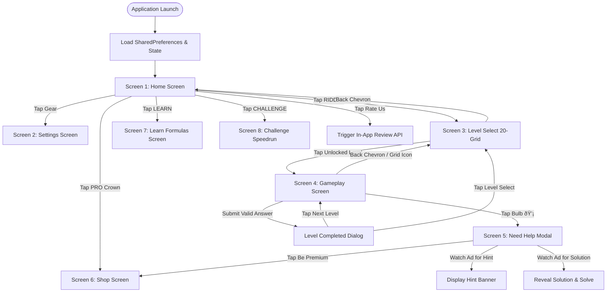

## 3. Screen-by-Screen Architecture & User Flows

### Global Screen Navigation State Diagram



---

### Screen 1: Home Screen

```
 ┌───────────────────────────────────────────────┐
 │               [❤️ 5] [★ 125 PTS] [⚙]          │
 │                                   [👑]        │
 │                 MATH RIDDLES                  │
 │                                               │
 │    "Logic is the anatomy of thought.          │
 │     Challenge your limits."                   │
 │                                               │
 │         ┌───────────────────────────┐         │
 │         │  [▶]    R I D D L E       │         │
 │         └───────────────────────────┘         │
 │         ┌───────────────────────────┐         │
 │         │  [📖]   L E A R N         │         │
 │         └───────────────────────────┘         │
 │         ┌───────────────────────────┐         │
 │         │  [⏱]    C H A L L E N G E │         │
 │         └───────────────────────────┘         │
 │                                               │
 │               Rate Us ★★★★★                   │
 └───────────────────────────────────────────────┘
```

* **Top-Right Navigation Stack:**
  * **Compact Amber Score Indicator (`★ Total Points`):** Outlined minimalist dark pill displaying player's persistent points with animated value transitions, situated immediately beside the Settings gear icon. Tapping opens the Scoring System breakdown.
  * **Settings Gear Button:** Bordered circular outline (`42x42dp`), navigating to [SettingsScreen](file:///c:/Users/gokul/code/math/lib/screens/settings_screen.dart).
  * **PRO Crown Badge:** Bordered compact pill placed directly beneath the settings icon. Highlights an amber crown with `PRO` label; routes to [ShopScreen](file:///c:/Users/gokul/code/math/lib/screens/shop_screen.dart).
* **Center Branding & Hero Quote:**
  * Bold title: `MATH RIDDLES` (`32sp`, letter spacing `4.0px`).
  * Philosophical hero quote: *“Logic is the anatomy of thought. Challenge your limits.”* (`13sp`, italic, light grey).
* **Primary Menu Buttons:**
  * Three vertical stacked outline buttons with dark fill and subtle borders (`#2A2E39`):
    1. **RIDDLE:** Routes to [LevelsScreen](file:///c:/Users/gokul/code/math/lib/screens/levels_screen.dart).
    2. **LEARN:** Routes to [LearnScreen](file:///c:/Users/gokul/code/math/lib/screens/learn_screen.dart).
    3. **CHALLENGE:** Routes to [ChallengeScreen](file:///c:/Users/gokul/code/math/lib/screens/challenge_screen.dart).
* **Footer:**
  * Clean, interactive **Rate Us ★★★★★** button opening store review prompts.

---

### Screen 2: Settings Screen

```
 ┌───────────────────────────────────────────────┐
 │ [<] SETTINGS                                  │
 │                                               │
 │  ┌─────────────────────────────────────────┐  │
 │  │ 🔊 SOUND                          [ON]  │  │
 │  ├─────────────────────────────────────────┤  │
 │  │ 📳 VIBRATION                      [ON]  │  │
 │  ├─────────────────────────────────────────┤  │
 │  │ 🎬 ADS SETTING                     [>]  │  │
 │  ├─────────────────────────────────────────┤  │
 │  │ 🔄 RESTORE PURCHASE                [>]  │  │
 │  ├─────────────────────────────────────────┤  │
 │  │ 🗑 DELETE DATA                     [>]  │  │
 │  └─────────────────────────────────────────┘  │
 │                                               │
 │         Privacy Policy  •  Terms of Service   │
 └───────────────────────────────────────────────┘
```

* **Header:** Back chevron `<` with clean title `SETTINGS`.
* **Actionable Configuration Rows:**
  * **SOUND:** Toggle switch to activate/deactivate sound effects.
  * **VIBRATION:** Toggle switch to activate/deactivate haptic feedback.
  * **ADS SETTING:** Consent management and personalized ad preferences.
  * **RESTORE PURCHASE:** Queries Google Play Billing / Apple StoreKit to re-grant previous non-consumable and subscription purchases.
  * **DELETE DATA:** Warning-accented row with trash icon. Opens a confirmation modal: *“Reset all progress? This will lock all levels and clear timer records permanently.”*
* **Footer:** Clean text links for **Privacy Policy** and **Terms of Services**.

---

### Screen 3: Riddle Level Select (20-Container Grid)

```
 ┌───────────────────────────────────────────────┐
 │ [<] LEVEL SELECT                              │
 │                                               │
 │       ┌──────┐ ┌──────┐ ┌──────┐ ┌──────┐     │
 │       │ 1  ✓ │ │ 2  ✓ │ │ 3  ✓ │ │ 4  ✓ │     │
 │       └──────┘ └──────┘ └──────┘ └──────┘     │
 │       ┌──────┐ ┌──────┐ ┌──────┐ ┌──────┐     │
 │       │[5] ☼ │ │ 6  🔒│ │ 7  🔒│ │ 8  🔒│     │
 │       └──────┘ └──────┘ └──────┘ └──────┘     │
 │       ┌──────┐ ┌──────┐ ┌──────┐ ┌──────┐     │
 │       │ 9  🔒│ │10  🔒│ │11  🔒│ │12  🔒│     │
 │       └──────┘ └──────┘ └──────┘ └──────┘     │
 │       ┌──────┐ ┌──────┐ ┌──────┐ ┌──────┐     │
 │       │13  🔒│ │14  🔒│ │15  🔒│ │16  🔒│     │
 │       └──────┘ └──────┘ └──────┘ └──────┘     │
 │       ┌──────┐ ┌──────┐ ┌──────┐ ┌──────┐     │
 │       │17  🔒│ │18  🔒│ │19  🔒│ │20  🔒│     │
 │       └──────┘ └──────┘ └──────┘ └──────┘     │
 └───────────────────────────────────────────────┘
```

* **Header:** Back chevron `<` and `LEVEL SELECT` heading.
* **Responsive 20-Tile Grid:**
  * Exactly 20 uniform square boxes.
  * **Sequential Unlocking Rule:** Level 1 is unlocked by default. Level $N$ unlocks strictly when Level $N-1$ is solved.
  * **Tile States:**
    * **Completed:** Shows level digit in bold white with a green checkmark `✓`.
    * **Active (Current):** Highlighted with glowing amber border (`#E5A93C`) and active background.
    * **Locked:** Displays a muted padlock glyph with dim typography; touch events disabled.

---

### Screen 4: Question & Riddle Gameplay Screen

```
 ┌───────────────────────────────────────────────┐
 │ [<]        LEVEL 5   ⏱ 04:32             [⊞] │
 ├───────────────────────────────────────────────┤
 │                                               │
 │                     ( 5 )                     │
 │                     /   \                     │
 │                    / [ ? ]\                   │
 │                   /       \                   │
 │                ( 3 ) ---- ( 4 )               │
 │                                               │
 ├───────────────────────────────────────────────┤
 │  INPUT: [ 25 ]                [✕]   [💡 HELP] │
 ├───────────────────────────────────────────────┤
 │   ┌───────────┬───────────┬───────────┐       │
 │   │     1     │     2     │     3     │       │
 │   ├───────────┼───────────┼───────────┤       │
 │   │     4     │     5     │     6     │       │
 │   ├───────────┼───────────┼───────────┤       │
 │   │     7     │     8     │     9     │       │
 │   ├───────────┼───────────┼───────────┤       │
 │   │    DEL    │     0     │   ENTER   │       │
 │   └───────────┴───────────┴───────────┘       │
 └───────────────────────────────────────────────┘
```

* **Header Bar:**
  * Back Chevron `<` (navigates back to Level Select).
  * Center: **LEVEL X** indicator paired with a continuous active **5:00 countdown timer** formatted as `MM:SS`.
  * Right: Level Select shortcut icon `[⊞]`.
* **Central Puzzle Stage:**
  * Dynamic vector rendering via [`PuzzleCanvasPainter`](file:///c:/Users/gokul/code/math/lib/painters/puzzle_canvas_painter.dart) adapting to `Formula`, `Grid`, or `Geometry`.
  * Target value rendered as a stylized missing box (`?`) with idle pulse animation.
* **Bottom Keypad Stage:**
  * **Live Input Display Row:** Shows currently keyed-in characters in large white text with backspace `✕` button and bulb `💡` help shortcut.
  * **Virtual Numeric Keypad:** Built-in digits `0` to `9`, `DEL`, and `ENTER`.
  * **No native OS keyboard is ever shown.**
* **Validation & Level Progression:**
  * **Error:** Horizontal shake animation, red flash border, and haptic vibration.
  * **Success:** Triggers celebratory level completion modal displaying the solution explanation and a `NEXT LEVEL` direct progression button.

---

### Screen 5: "Need Help?" Modal

* Triggered exclusively by tapping the bulb icon `💡`.
* High-contrast off-white dialog (`#F5F6F8`) on dark backdrop (`#CC000000`).
* **Options:**
  1. `[▶] Watch Ad for Hint` — Displays the level clue upon video completion.
  2. `[👑] Watch Ad for Solution OR Be Premium` — Reveals full step-by-step mathematical derivation and auto-completes stage.
  3. `[✕] No thanks` — Dismisses the modal.

---

### Screen 6: Shop / Premium Subscription Screen

* Outlined pricing cards with benefits breakdown:
  1. **REMOVE ADS (`₹49 / $0.99`):** Permanent non-consumable removal of interstitials and banners.
  2. **A MONTH PREMIUM (`₹99 / $1.99/mo`):** Auto-renewing subscription with zero ads, instant hints, and instant solutions.
  3. **LIFETIME PREMIUM (`₹199 / $4.99`):** Permanent VIP status, offline solution unlocks, VIP crown badge forever.
* Includes **Restore Purchases** button in footer.

---

### Screen 7: Learn Screen
* Conceptual walkthrough of core logic archetypes:
  * Number sequence properties (Arithmetic, Geometric, Fibonacci, Lucas).
  * Mental arithmetic tricks (squaring numbers ending in 5, cross-multiplication).
  * Matrix symmetry and determinant intuition.

---

### Screen 8: Challenge Screen
* Speedrun challenge mode:
  * Continuous 60-second time-attack clock.
  * Randomly drawn riddles from completed level pool.
  * Instant $+10\text{s}$ time bonus on correct answer, $-5\text{s}$ penalty on incorrect submission.

---

## 4. Puzzle Engine & Level Data Model

### Data Schema (Dart Model)

The riddle engine in [`lib/models/level_model.dart`](file:///c:/Users/gokul/code/math/lib/models/level_model.dart) is represented by this schema:

```dart
enum QuestionType {
  Formula,
  Grid,
  Geometry,
}

class PuzzleNode {
  final String id;
  final String displayValue;
  final bool isTarget;
  final double relX; // 0.0 (left) to 1.0 (right)
  final double relY; // 0.0 (top) to 1.0 (bottom)

  const PuzzleNode({
    required this.id,
    required this.displayValue,
    this.isTarget = false,
    this.relX = 0.5,
    this.relY = 0.5,
  });
}

class GameLevel {
  final int levelNumber;
  final QuestionType questionType;
  final String displayContent;
  final List<PuzzleNode> nodes;
  final String correctAnswer;
  final String hint;
  final String solution;

  const GameLevel({
    required this.levelNumber,
    required this.questionType,
    required this.displayContent,
    required this.nodes,
    required this.correctAnswer,
    required this.hint,
    required this.solution,
  });
}
```

### Vector Canvas Rendering Archetypes

Implemented in [`PuzzleCanvasPainter`](file:///c:/Users/gokul/code/math/lib/painters/puzzle_canvas_painter.dart):
1. **Formula (`QuestionType.Formula`):** Renders dynamic multiline algebraic relations enclosed in outlined cards.
2. **Grid (`QuestionType.Grid`):** Generates 2x2 and 3x3 uniform coordinate matrices with custom boundary lines and centered values.
3. **Geometry (`QuestionType.Geometry`):** Draws vector lines between `PuzzleNode` vertices (triangles, concentric circles, intersecting polygons) with glowing target `?` nodes.

---

### Scoring Engine & Point Economy

The game incorporates a persistent scoring mechanism designed to reward mental mastery across all game modes:

| Game Mode / Activity | Point Value | Escalation & Unlocking Rules |
|:---|:---:|:---|
| **Riddle Campaign (Levels 1–10)** | **+5 PTS** per solve | Base points for first-time completion of early campaign stages. |
| **Riddle Campaign (Levels 11–20)** | **+15 PTS** per solve | Increases by **+10 PTS** for every 10 levels completed ($5 + 10 = 15$). |
| **Learn Mode Concepts** | **+50 PTS** per concept | Awarded upon mastering and claiming each conceptual lesson. |
| **Speedrun Challenges** | **+3 PTS** per solve | Fast-paced time-attack rewards for each correctly solved equation. |

#### UI Placement & Visibility
* **Home Screen:** Displayed in the **Top-Right Corner beside Settings** as a compact amber pill (`[★ 125 PTS]`) with subtle animated transitions. Tapping opens the Scoring System rules dialog.
* **Level Select, Learn & Challenge Screens:** Positioned cleanly on the right of the App Bar.
* **Gameplay Stage:** Displayed in the header alongside the timer and celebrated with a `+X PTS EARNED!` badge on the Level Cleared dialog.

---

### Hearts & Energy Economy (5 Hearts, 20-Min Refill)

The game implements a fair, time-based heart/energy mechanic:
* **Capacity:** Maximum 5 hearts (`❤️ 5`).
* **Consumption:** Submitting an incorrect answer consumes 1 heart. Correct answers consume 0 hearts.
* **Refill Rate:** 1 heart refills automatically every **20 minutes** (1200 seconds), calculating time elapsed offline even when the app is closed.
* **Out of Hearts:** Submissions are paused when hearts reach 0. Players can:
  1. Wait for the 20-minute automatic refill.
  2. Watch a rewarded video ad for an instant **+1 Heart**.
  3. Upgrade to **Premium / VIP** for **Unlimited Hearts ($\infty$)**.
* **Visual Representation:** Compact heart indicator (`[❤️ 5]` or `[❤️ 4 (18:22)]` or `[❤️ ∞]`) on the Home Screen and Gameplay header. Tapping opens an Energy breakdown modal.

---

### Complete 20-Level Mathematical Master Catalog

The application ships with 20 handcrafted levels in [`lib/data/game_levels.dart`](file:///c:/Users/gokul/code/math/lib/data/game_levels.dart):

| Lvl | Type | Display / Logic Pattern | Answer | Mathematical Explanation |
|:---:|:---|:---|:---:|:---|
| **1** | `Formula` | $2+3=10$, $7+2=63$, $6+5=66$, $8+4=?$ | `96` | Formula: $(a + b) \times a$. For $8+4$: $(8+4)\times 8 = 12\times 8 = 96$. |
| **2** | `Geometry` | Triangle: Outer nodes $(3, 4, 5)$, Center: $?$ | `25` | Pythagorean sum: $3^2 + 4^2 = 25 = 5^2$. Center is $25$. |
| **3** | `Grid` | $2\times 2$ Matrix: $[3, 9; 5, ?]$ | `25` | Row rule: $x \to x^2$. Row 1: $3^2 = 9$. Row 2: $5^2 = 25$. |
| **4** | `Geometry` | Concentric circles: Inner $4$, Middle $8$, Outer $?$ | `16` | Exponential doubling: $4 \times 2 = 8$, $8 \times 2 = 16$. |
| **5** | `Formula` | $1=5$, $2=25$, $3=125$, $4=625$, $5=?$ | `1` | Equivalence symmetry: If $1 = 5$, then $5 = 1$. |
| **6** | `Geometry` | Triangle: Top $4$, Left $3$, Right $5$, Center $?$ | `60` | Product rule: $4 \times 3 \times 5 = 60$. |
| **7** | `Grid` | $2\times 2$ Matrix: $[2, 4; 8, ?]$ | `16` | Doubling progression across cells: $2, 4, 8, 16$. |
| **8** | `Geometry` | 4-node square: $(2, 3, 4, 5)$, Center: $?$ | `14` | Diagonal summation: $(2+5) + (3+4) = 14$. |
| **9** | `Formula` | $3 \times 3 = 18$, $4 \times 4 = 32$, $5 \times 5 = 50$, $6 \times 6 = ?$ | `72` | Formula: $2 \times (n^2)$. For $6$: $2 \times 36 = 72$. |
| **10** | `Geometry` | Triangle: Outer $(6, 7, 8)$, Center: $?$ | `21` | Arithmetic sum: $6 + 7 + 8 = 21$. |
| **11** | `Grid` | $2\times 2$ Matrix: $[7, 14; 21, ?]$ | `28` | Multiples of 7: $7, 14, 21, 28$. |
| **12** | `Geometry` | Two intersecting circles: $(5, ?, 10)$, Center $15$ | `5` | Set sum: $5 + ? + 5 = 15 \implies ? = 5$. |
| **13** | `Formula` | $1+4=5$, $2+5=12$, $3+6=21$, $8+11=?$ | `96` | Formula: $a + (a \times b)$. For $8+11$: $8 + (8 \times 11) = 96$. |
| **14** | `Geometry` | Triangle: Top $9$, Left $3$, Right $3$, Center: $?$ | `1` | Division rule: $9 \div 3 \div 3 = 1$. |
| **15** | `Grid` | $2\times 2$ Matrix: $[1, 8; 27, ?]$ | `64` | Perfect cubes: $1^3=1, 2^3=8, 3^3=27, 4^3=64$. |
| **16** | `Geometry` | Triangle: Outer $(11, 13, 17)$, Center: $?$ | `41` | Prime summation: $11 + 13 + 17 = 41$. |
| **17** | `Formula` | $4+4=20$, $5+5=30$, $6+6=42$, $7+7=?$ | `56` | Formula: $n \times (n + 1)$. For $7$: $7 \times 8 = 56$. |
| **18** | `Geometry` | Triangle: Outer $(2, 3, 5)$, Center: $?$ | `30` | Prime factorization product: $2 \times 3 \times 5 = 30$. |
| **19** | `Grid` | $2\times 2$ Matrix: $[10, 20; 40, ?]$ | `80` | Geometric progression: $10 \times 2^n \implies 80$. |
| **20** | `Formula` | $9=90$, $8=72$, $7=56$, $6=42$, $3=?$ | `12` | Formula: $n \times (n + 1)$. For $3$: $3 \times 4 = 12$. |

---

## 7. Technical Architecture & State Management

### Riverpod 3 Notifier State Lifecycle

Implemented in [`lib/controllers/game_controller.dart`](file:///c:/Users/gokul/code/math/lib/controllers/game_controller.dart):

```dart
class GameState {
  final int currentLevelIndex;
  final Set<int> completedLevels;
  final int unlockedLevelIndex;
  final int remainingSeconds; // 5-minute countdown (300 down to 0)
  final String currentInput;
  final bool isError;
  final bool isSolved;
  final bool isHintRevealed;
  final bool isSolutionRevealed;
  final bool isPremium;
}

class GameController extends Notifier<GameState> {
  Timer? _countdownTimer;

  void startTimer() {
    _countdownTimer?.cancel();
    _countdownTimer = Timer.periodic(const Duration(seconds: 1), (timer) {
      if (state.remainingSeconds > 0) {
        state = state.copyWith(remainingSeconds: state.remainingSeconds - 1);
      } else {
        timer.cancel();
      }
    });
  }

  void appendInput(String digit) {
    if (state.currentInput.length < 6) {
      state = state.copyWith(
        currentInput: state.currentInput + digit,
        isError: false,
      );
    }
  }

  void backspace() {
    if (state.currentInput.isNotEmpty) {
      state = state.copyWith(
        currentInput: state.currentInput.substring(0, state.currentInput.length - 1),
        isError: false,
      );
    }
  }

  bool submitAnswer() {
    final currentLevel = GameLevels.allLevels[state.currentLevelIndex];
    if (state.currentInput.trim() == currentLevel.correctAnswer.trim()) {
      _markLevelCompleted(currentLevel.levelNumber);
      return true;
    } else {
      state = state.copyWith(isError: true);
      return false;
    }
  }
}
```

### Offline Persistence & SharedPreferences Schema

Implemented in [`lib/services/progress_service.dart`](file:///c:/Users/gokul/code/math/lib/services/progress_service.dart):

| Preference Key | Type | Default | Description |
|:---|:---|:---|:---|
| `math_unlocked_level` | `int` | `1` | Highest unlocked level index (1 to 20) |
| `math_completed_levels` | `List<String>` | `[]` | Serialized list of completed level IDs |
| `math_sound_enabled` | `bool` | `true` | UI and validation sound effects toggle |
| `math_vibration_enabled`| `bool` | `true` | Keypress and error haptic feedback toggle |
| `math_ads_enabled` | `bool` | `true` | Personalized ads consent flag |
| `math_is_premium` | `bool` | `false` | In-app purchase VIP entitlement flag |

### Error Handling & Edge Cases

1. **Timer Expiry (00:00):** Does not lock or fail the player; transitions timer to amber pulse mode to prompt hint consultation.
2. **Rapid Keypad Tapping:** Virtual keypad includes a 50ms software debounce to prevent duplicate key injection.
3. **App Minimization / Backgrounding:** The 5-minute timer records background exit timestamp and resumes with accurate delta on foreground resume.

---

## 8. Setup, Build & Test Verification

### Prerequisites
* **Flutter SDK:** Version `3.27.0` or higher
* **Java JDK:** OpenJDK 17 (Eclipse Temurin 17.0.21+)
* **Android SDK:** Platforms 34 / 36 with Build-Tools `36.0.0`

### Environment Configuration (PowerShell)
```powershell
$env:JAVA_HOME = "C:\src\jdk-17"
$env:ANDROID_HOME = "$env:LOCALAPPDATA\Android\Sdk"
$env:PATH = "C:\src\flutter\bin;C:\src\jdk-17\bin;$env:LOCALAPPDATA\Android\Sdk\cmdline-tools\latest\bin;$env:LOCALAPPDATA\Android\Sdk\platform-tools;$env:PATH"
Set-Location "c:\Users\gokul\code\math"
```

### Running Test Suite
```powershell
flutter test
# Expected: All tests passed! (lib/main.dart & test/widget_test.dart)
```

### Running Static Code Analysis
```powershell
flutter analyze
# Expected: No issues found! (0 errors, 0 warnings)
```

### Building Android APK
```powershell
# Assemble Debug APK
flutter build apk --debug

# Output location:
# build/app/outputs/flutter-apk/app-debug.apk
```

### Running Live on Device / Browser
```powershell
# Preview in Chrome / Web
flutter run -d chrome

# Launch on connected Android device
flutter run
```

---

