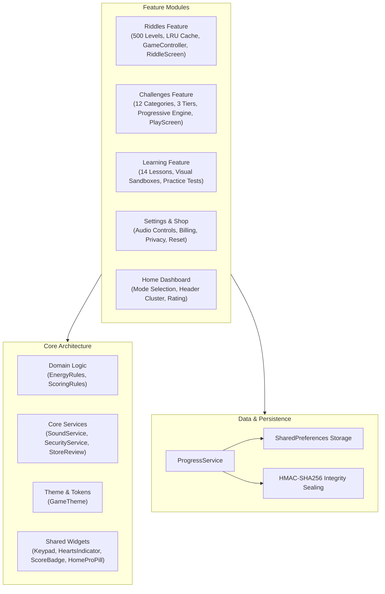
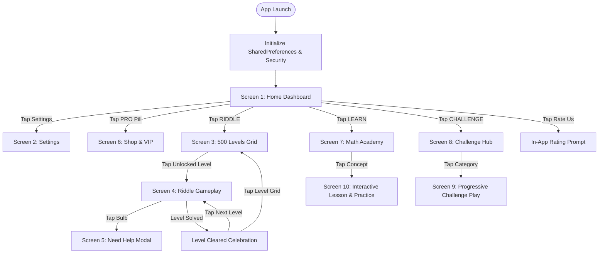

# SMATH – Technical Architecture & Screen Specifications

> **Target Framework:** Flutter 3.27+ / Dart 3.6+  
> **Platforms:** Android (API 26+) & iOS (iOS 14.0+)  
> **State Management:** Riverpod 3  
> **Persistence:** SharedPreferences with Cryptographic HMAC-SHA256 Signing  

---

## 1. System Architecture & Feature Modules

SMATH is built upon a feature-based modular architecture enforcing strict separation of concerns between UI presentation, business logic, domain models, and infrastructure services:



---

## 2. Global Navigation Flow



---

## 3. Screen-by-Screen Specifications

### Screen 1: Home Dashboard (`HomeScreen`)
* **Top Header Cluster (Single Row):**
  * `HeartsIndicator`: Displays current hearts (`❤️ 5`, `❤️ 4 (18:22)`, or `❤️ ∞` for VIP) with remaining refill countdown.
  * `ScoreBadge`: Outlined amber pill showing persistent player points (`★ 125 PTS`). Tapping opens scoring rules.
  * `HomeProPill`: Understated, non-intrusive pill showing `PRO` badge. Tapping opens the Shop screen.
  * `SettingsGear`: Borderless circular button navigating to `SettingsScreen`.
* **Center Branding:**
  * Title: `MATH RIDDLES` (`34sp`, font weight 800, tracking `2.0px`).
  * Hero Quote: *“Logic is the anatomy of thought. Challenge your limits.”* (`11sp`, italic, light grey).
* **Primary Game Modes:**
  * **RIDDLE:** Routes to `LevelsScreen` (500 levels organized in 10 packs of 50).
  * **LEARN:** Routes to `LearnScreen` (14 conceptual lessons with interactive sandboxes).
  * **CHALLENGE:** Routes to `ChallengeScreen` (12 progressive challenge categories).
* **Footer:**
  * Interactive **Rate Us ★★★★★** button triggering Google Play Store rating.

---

### Screen 2: Settings Screen (`SettingsScreen`)
* **Sound Controls:** Toggle switch for sound effects + interactive volume slider (0% to 100%).
* **Vibration:** Toggle switch for haptic feedback.
* **Ads Setting:** Opens Google UMP consent preferences dialog.
* **Restore Purchases:** Queries Play Billing / StoreKit to restore non-consumable and subscription entitlements.
* **Reset Progress:** Warning-accented row triggering a confirmation modal to safely reset all user records.
* **Footer:** Privacy Policy and Terms of Service legal links.

---

### Screen 3: Riddle Level Select (`LevelsScreen`)
* **Pack-Based Architecture:** 500 levels structured into 10 collapsible packs:
  * Pack 1: Levels 1–50 (Foundational Logic)
  * Pack 2: Levels 51–100 (Algebraic Patterns)
  * ...
  * Pack 10: Levels 451–500 (Master Series & Grand Singularity)
* **Sequential Unlocking Rule:** Level 1 is unlocked initially. Level $N$ unlocks strictly when Level $N-1$ is solved.
* **Tile States:**
  * *Completed:* Displays level number with a green checkmark (`✓`).
  * *Active:* Highlighted with an amber border (`#E5A93C`) and illuminated background.
  * *Locked:* Displays a lock icon with disabled touch interactions.

---

### Screen 4: Riddle Gameplay Screen (`RiddleScreen`)
* **Header Bar:** Back button, Level title, 5-minute continuous countdown timer, hearts display, and level select shortcut.
* **Vector Puzzle Canvas:** Dynamically rendered via `PuzzleCanvasPainter`:
  * *Formula:* Multiline algebraic equations.
  * *Grid:* 2x2 and 3x3 numeric matrices with centered values.
  * *Geometry:* Vector lines connecting vertices (triangles, squares, concentric circles) with an animated target `?` box.
* **Live Input Display Row:** Shows current keyed digits with backspace (`✕`) and bulb (`💡`) help button.
* **Inbuilt Numeric Keypad:** Dedicated 12-key tactile virtual pad (`0–9`, `DEL`, `ENTER`). Native OS keyboards are completely suppressed.
* **Validation & Energy:**
  * *Correct Submission:* Haptic pulse, celebratory Level Cleared dialog, +PTS award, auto-unlock of next level.
  * *Incorrect Submission:* Error shake animation, red outline flash, deduction of 1 heart. If hearts reach 0, displays the `OutOfHeartsModal`.

---

### Screen 5: "Need Help?" Modal (`NeedHelpModal`)
* Triggered exclusively by tapping the bulb icon (`💡`).
* High-contrast dialog with clear action options:
  1. **Watch Ad for Hint:** Displays the conceptual clue for the active level.
  2. **Watch Ad for Solution OR Be Premium:** Unlocks full mathematical derivation and completes the level.
  3. **No Thanks:** Dismisses the dialog.

---

### Screen 6: Shop & Premium (`ShopScreen`)
* Outlined product cards displaying real-time pricing and benefits:
  * **Remove Ads:** Non-consumable permanent removal of interstitial ads.
  * **Monthly Premium:** Auto-renewing subscription with Unlimited Hearts, ad removal, and instant hints/solutions.
  * **Lifetime VIP:** Permanent access to Unlimited Hearts, ad-free gameplay, offline solution unlocks, and PRO badge.
* Restore purchases action button in footer.

---

### Screen 7: Interactive Math Academy (`LearnScreen` & `LessonDetailScreen`)
* **Curriculum:** 14 lessons across 3 chapters: Foundational Arithmetic, Pattern Recognition, and Advanced Geometry.
* **Modular Visual Sandboxes:**
  * *Balance Scale:* Drag-free dynamic algebraic equilibrium.
  * *Clock Modular Dial:* Circular wrap-around arithmetic visualization.
  * *Binary Bit Flipper:* Interactive bits demonstrating base-2 positional notation.
  * *Fraction Visualizer:* Dynamic percentage and fraction bar.
* **Mastery Practice Quiz:** Graded question testing concept application. Awarding **+50 PTS** upon mastery (claimed once per lesson).

---

### Screen 8: Smart Progressive Challenges (`ChallengeScreen` & `ChallengePlayScreen`)
* **12 Categories:** Neutral card surfaces with shared amber-gold achievement styling.
* **Dynamic 3-Tier Progression:**
  * Tier 0: 1-digit arithmetic (baseline for all new players).
  * Tier 1: 2-digit arithmetic (unlocked at **20 cumulative solved answers** with $\ge 60\%$ accuracy).
  * Tier 2: 3-digit and composite expressions (unlocked at **40 cumulative solved answers** with $\ge 65\%$ accuracy).
* **Continuous Non-Terminating Runs:**
  * Incorrect answers display a compact 1.5-second inline feedback overlay with the correct answer and a concise one-line explanation.
  * Runs continue smoothly without abrupt modal interruptions.
* **Achievement Ranks:** Newbie → Beginner → Skilled → Expert → Master → Grandmaster.

---

## 4. Puzzle Engine & Data Schema

### Level Model Schema
```dart
enum QuestionType {
  formula,
  grid,
  geometry,
  mixed,
}

class PuzzleNode {
  final String id;
  final String displayValue;
  final bool isTarget;
  final double relX; // 0.0 to 1.0 relative horizontal coordinate
  final double relY; // 0.0 to 1.0 relative vertical coordinate

  const PuzzleNode({
    required this.id,
    required this.displayValue,
    this.isTarget = false,
    this.relX = 0.5,
    this.relY = 0.5,
  });
}

class LevelModel {
  final int levelNumber;
  final QuestionType questionType;
  final String displayContent;
  final List<PuzzleNode> nodes;
  final String correctAnswer;
  final String hint;
  final String solution;
  final int difficulty;

  const LevelModel({
    required this.levelNumber,
    required this.questionType,
    required this.displayContent,
    required this.nodes,
    required this.correctAnswer,
    required this.hint,
    required this.solution,
    this.difficulty = 1,
  });
}
```

### Repository & Scalable LRU Cache
* `ILevelRepository` abstracts level retrieval.
* `ScalableLevelRepository` stores handcrafted levels 1–20 in memory and dynamically generates procedural levels 21–500 using an LRU cache (capacity 50) and deterministic math seeds.

---

## 5. Offline Persistence & Cryptographic Security

### SharedPreferences Key Schema
| Key Identifier | Data Type | Default Value | Description |
|:---|:---|:---:|:---|
| `math_unlocked_level` | `int` | `1` | Highest unlocked riddle level (1 to 500) |
| `math_completed_levels` | `List<String>` | `[]` | Serialized list of solved riddle level IDs |
| `math_total_score` | `int` | `0` | Persistent player score |
| `math_current_hearts` | `int` | `5` | Current heart capacity (0 to 5) |
| `math_last_heart_timestamp` | `int` | `now` | Epoch milliseconds of last heart deduction/recovery |
| `math_sound_enabled` | `bool` | `true` | UI and validation sound effects toggle |
| `math_sound_volume` | `double` | `0.7` | Calibrated audio output volume (0.0 to 1.0) |
| `math_vibration_enabled` | `bool` | `true` | Haptic feedback toggle |
| `math_is_premium` | `bool` | `false` | In-app purchase entitlement status |
| `math_security_signature` | `String` | `""` | HMAC-SHA256 checksum over critical progress data |

### Cryptographic Security Protocol
* On each state mutation, critical values (`math_unlocked_level`, `math_total_score`, `math_completed_levels`) are signed with HMAC-SHA256 using an obfuscated salt.
* On app launch, the checksum is verified. If tampering is detected, progress is safely normalized to verified bounds to prevent cheat injections.
