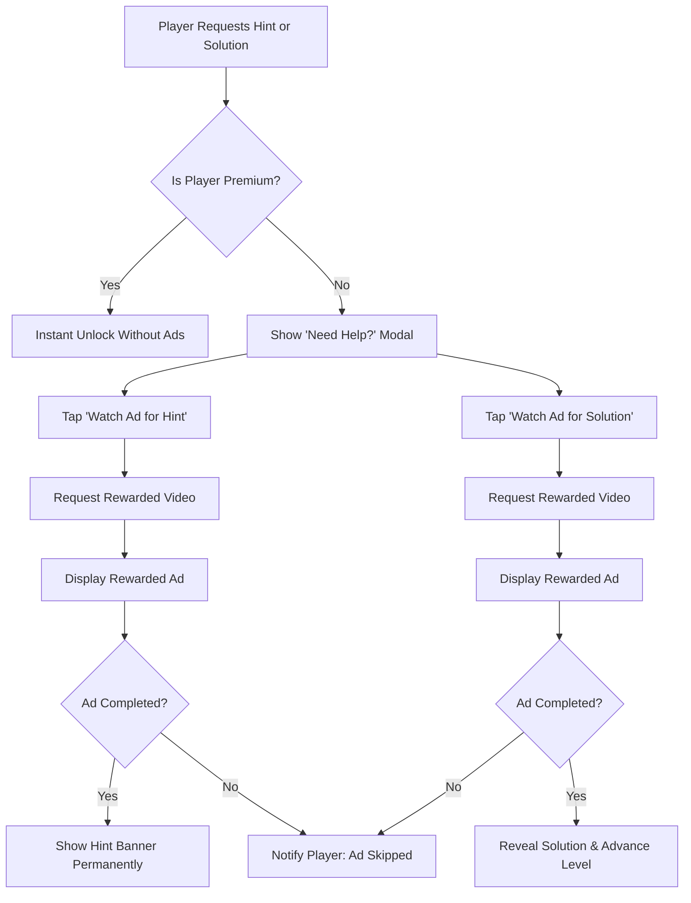
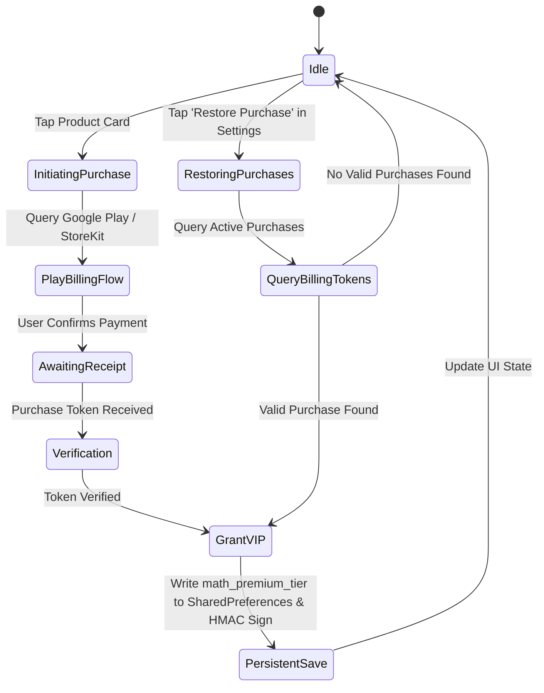

# SMATH – Monetization & In-App Purchases Specification

> **Document Type:** Monetization & Revenue Architecture  
> **Target Framework:** Flutter 3.27+ / Dart 3.6+  
> **Platforms:** Android (Google Play Billing) & iOS (Apple StoreKit)  
> **SKU Domain:** `com.valcire.mathriddle`  

---

## 1. Ad Strategy & Monetization Architecture

### Ad Units, Frequency Caps & Lifecycle Triggers

### Rewarded Video Implementation Rules
1. **100% User-Initiated:** Rewarded videos never play automatically. They require explicit taps on *"Watch Ad for Hint"* or *"Watch Ad for Solution"*.
2. **Reward Delivery Guarantee:**
   * Hint reward persists across app restarts for that specific level.
   * Solution reward reveals full workings and immediately unlocks Level $N+1$.
3. **Graceful Offline Fallback:** If an ad fails to load due to offline status, the app displays a graceful message encouraging the user to continue solving or subscribe to Premium.

### Interstitial Cadence & Suppression (Polite SMath Standard)
* **Riddle Cadence:** Interstitial ads display strictly after completing every 9th riddle level ($N = 9, 18, 27, 36, \dots$).
* **Challenge Cadence:** Zero in-game interruptions during the 15-second timed rounds. Interstitials are triggered ONLY when a player exits/backs off from a challenge session (after at least 2 attempts or 1 correct answer).
* **Global Cooldown:** Strict 120-second minimum cooldown between any interstitials across all app sections.
* **Suppression Rule:** 100% suppressed for all players with `isPremiumUser == true` or `isAdsRemoved == true`. Zero popups or interruptions forever.

### GDPR / CCPA Privacy & Consent Protocols
* Compliant with Google User Messaging Platform (UMP).
* A dedicated **ADS SETTING** toggle row in [SettingsScreen](file:///c:/Users/gokul/code/math/lib/screens/settings_screen.dart) allows players to adjust personalized advertising consent at any time.

---

## 2. In-App Purchases & Pricing Model

### Product Tiers & Multi-Currency Pricing

| Tier Identifier | SKU / Product ID | Billing Type | INR (₹) | USD ($) | EUR (€) | GBP (£) | Psychological Anchor |
|:---|:---|:---|:---:|:---:|:---:|:---:|:---:|
| **Ad-Free Starter** | `math_remove_ads` | Non-Consumable | ₹49 | $0.99 | €0.99 | £0.89 | Impulse / Frictionless |
| **30-Day Pro Pass** | `math_premium_monthly` | 30-Day Pass | ₹99 | $1.99 | €1.99 | £1.79 | Decoy Tier |
| **Lifetime VIP Pass** | `math_premium_lifetime`| Non-Consumable | ₹199 | $4.99 | €4.99 | £4.49 | Anchored vs ₹399 / $9.99 (50% OFF) |

### Comprehensive Feature Matrix

| Capability / Benefit | Free Tier | Remove Ads Tier | Monthly Subscription | Lifetime VIP Access |
|:---|:---:|:---:|:---:|:---:|
| **All 500 Riddles Access** | Yes | Yes | Yes | Yes |
| **12 Progressive Challenges** | Yes | Yes | Yes | Yes |
| **14 Academy Lessons & Sandboxes** | Yes | Yes | Yes | Yes |
| **Unlimited Hearts (No 20m Wait)** | No | No | **Active** | **Active (Lifetime)** |
| **Interstitial Ads (Every 9 Levels / Session Exit)** | Active | **Disabled** | **Disabled** | **Disabled** |
| **Hint Access** | Watch Ad | Watch Ad | **Instant / Ad-Free** | **Instant / Ad-Free** |
| **Step-by-Step Solutions** | Watch Ad | Watch Ad | **Instant / Ad-Free** | **Instant / Ad-Free** |
| **Understated Home PRO Pill** | Discoverable | Discoverable | **Active Badge** | **Active Badge** |
| **Offline Solution Unlocks** | No | No | Yes | **Yes (Permanent)** |

### Billing State Machine & Purchase Restoration

