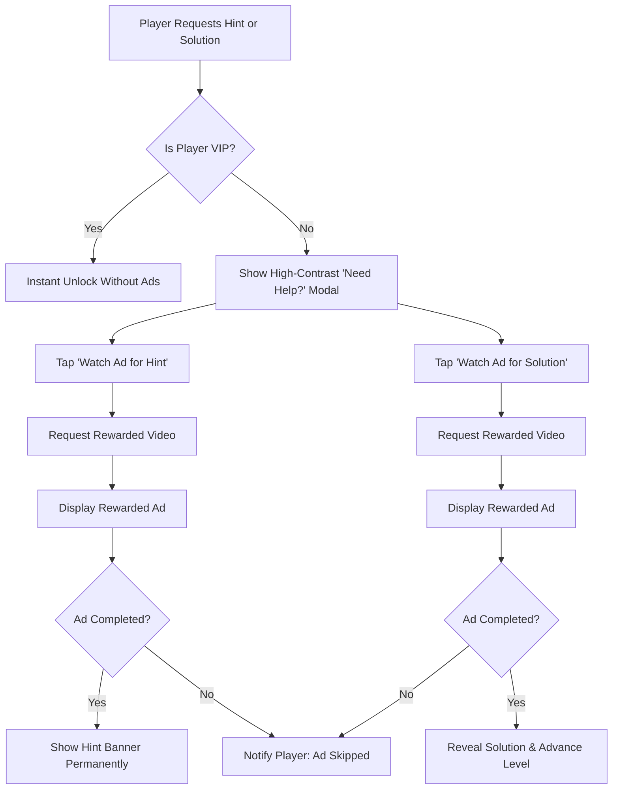
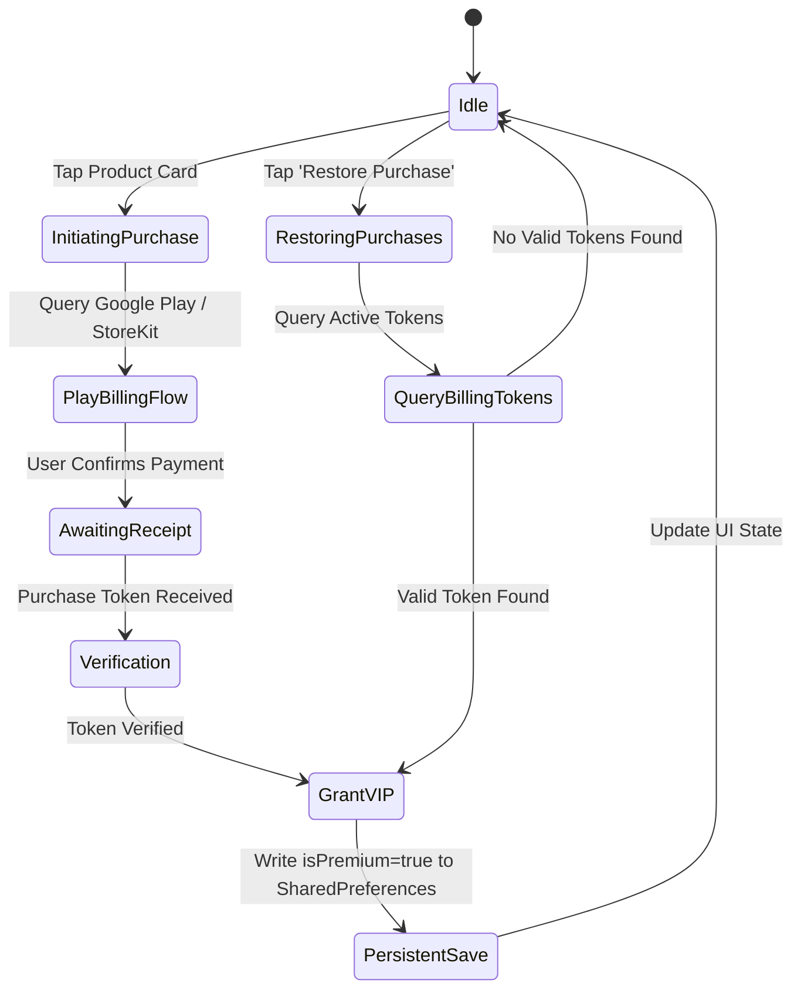

## 5. Ad Strategy & Monetization Architecture

### Ad Units, Frequency Caps & Lifecycle Triggers

### Rewarded Video Implementation Rules
1. **100% User-Initiated:** Rewarded videos never play automatically. They require explicit taps on either *"Watch Ad for Hint"* or *"Watch Ad for Solution"*.
2. **Reward Delivery Guarantee:**
   * Hint reward persists across app restarts for that specific level.
   * Solution reward reveals full workings and immediately unlocks Level $N+1$.
3. **No Penalty on Network Drop:** If an ad fails to load due to offline status, the app displays a graceful offline dialog encouraging the user to keep trying or subscribe to Premium.

### Interstitial Cadence & Suppression
* **Trigger Cadence:** Interstitial ads display strictly after completing every 3rd level ($N = 3, 6, 9, 12, 15, 18$).
* **Minimum Cooldown:** 60 seconds between interstitials to prevent fatigue.
* **Suppression Rule:** 100% suppressed for all players with `isPremium = true` or `removeAds = true`.

### GDPR / CCPA Privacy & Consent Protocols
* Integrated with Google User Messaging Platform (UMP).
* A dedicated **ADS SETTING** row in [SettingsScreen](file:///c:/Users/gokul/code/math/lib/screens/settings_screen.dart) allows players to revoke or adjust personalized advertising consent at any time.

---

## 6. In-App Purchases & Pricing Model

### Product Tiers & Multi-Currency Pricing

| Tier Identifier | SKU / Product ID | Billing Type | INR (₹) | USD ($) | EUR (€) | GBP (£) |
|:---|:---|:---|:---:|:---:|:---:|:---:|
| **Remove Ads** | `math_remove_ads` | Non-Consumable | ₹49 | $0.99 | €0.99 | £0.89 |
| **Monthly Premium** | `math_sub_monthly` | Auto-Renewing Sub | ₹99/mo | $1.99/mo | €1.99/mo | £1.79/mo |
| **Lifetime Access** | `math_lifetime_vip`| Non-Consumable | ₹199 | $4.99 | €4.99 | £4.49 |

### Comprehensive Feature Matrix

| Capability / Benefit | Free Tier | Remove Ads Tier | Monthly Subscription | Lifetime VIP Access |
|:---|:---:|:---:|:---:|:---:|
| **All 20 Handcrafted Levels** | Yes | Yes | Yes | Yes |
| **5-Minute Continuous Countdown Timer** | Yes | Yes | Yes | Yes |
| **Inbuilt Virtual Keypad** | Yes | Yes | Yes | Yes |
| **Interstitial Ads (Every 3 Levels)** | Active | **Disabled** | **Disabled** | **Disabled** |
| **Cross-Promotion Banner** | Active | **Disabled** | **Disabled** | **Disabled** |
| **Hints Access** | Watch Ad | Watch Ad | **Instant / Ad-Free** | **Instant / Ad-Free** |
| **Step-by-Step Solutions** | Watch Ad | Watch Ad | **Instant / Ad-Free** | **Instant / Ad-Free** |
| **Offline Solution Unlocks** | No | No | Yes | **Yes (Permanent)** |
| **VIP Crown Badge on Home Screen** | No | No | Yes | **Yes (Permanent Gold)** |
| **Priority Access to Future Levels** | No | No | Yes | **Yes** |

### Billing State Machine & Purchase Restoration

---

